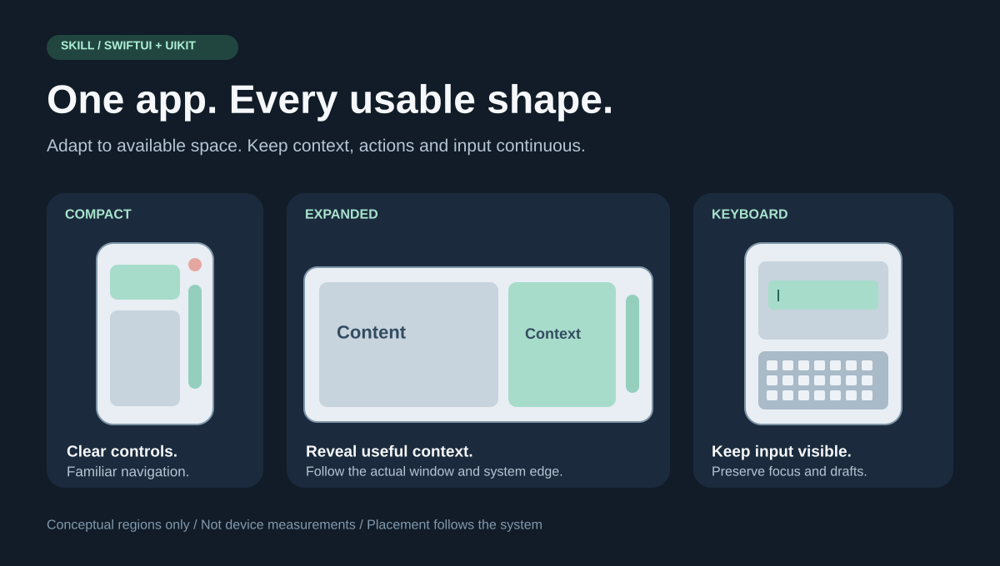
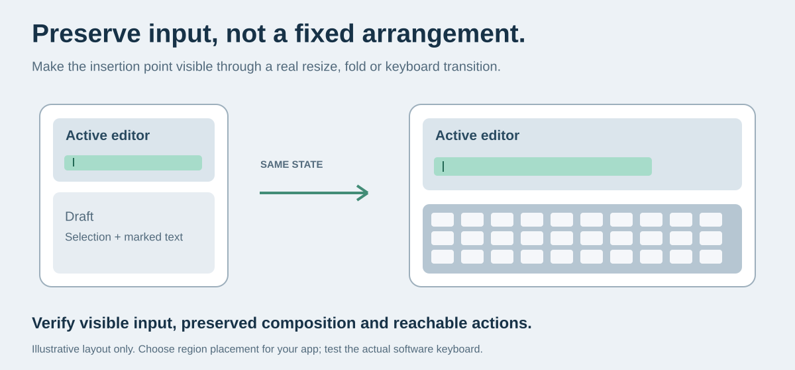

# iPhone Duo 迁移与测试 Skill

[English](README.md) · **简体中文**

面向 SwiftUI / UIKit 的通用迁移 Skill 与工具集，帮助应用适配 iPhone Duo，同时保证普通 iPhone 的体验不退化。



*配图是通用概念示意，不是设备规格图或某个 App 的截图。分栏方式仅作示例，应由产品任务决定。*

## 解决哪些问题

- 摄像头、安全区与折痕避让，同时检查按钮的实际响应区域。
- 系统侧边工具栏、溢出菜单与非对称边距。
- 折叠、展开和旋转期间保持导航、选择、草稿、焦点与输入法组合文本。
- 软件键盘、半折叠和多任务窗口中的真实输入体验。
- 普通手机和原最低支持系统的回归测试。
- 可选的真实模拟器截图与同色背景构图工具。

内容不依赖具体产品：不要求卡片界面、固定左右顺序、等宽分栏、某种配色，也不要求所有编辑器都放在上半屏。官方平台行为与产品实现选择分别说明。

## 快速使用

### 让 Agent 执行迁移

仓库根目录就是完整 Skill。Codex 可克隆到技能目录：

```sh
git clone https://github.com/TanShilongMario/iPhoneDuo.git \
  "${CODEX_HOME:-$HOME/.codex}/skills/iphone-duo-migration"
```

调用示例：

```text
使用 $iphone-duo-migration 审计这个 iOS App，迁移自适应布局，
验证 Duo 各形态与普通 iPhone。保留原部署下限与数据模型；
确需改变时先说明原因，并交付实际测试证据。
```

其他 Agent 可直接读取 [SKILL.md](SKILL.md)。英文指南和脚本也可以独立使用，不依赖某个 Agent 产品。

### 运行只读审计

```sh
python3 scripts/audit_layout.py /path/to/your/app --format markdown
```

脚本查找全局屏幕假设、按方向判布局、按机型限制功能、固定内容尺寸、编辑器身份变化等候选风险。它不改源码，也不能证明适配已经通过，结果需要人工判断。

### 执行测试并留证据

按照 [迁移指南](references/migration.md) 实现，执行 [测试矩阵](references/testing.md)，复制 [报告模板](assets/migration-report.md) 记录结果。必须弹出真实软件键盘测试，不能只凭电脑键盘或 Preview 判断输入正常。



*需要保证的是输入可见、状态连续。示意图展示一种可能的组织方式，并不规定应用必须采用该布局。*

## 仓库内容

| 内容 | 用途 |
| --- | --- |
| [SKILL.md](SKILL.md) | Agent 入口与工作流程 |
| [迁移指南](references/migration.md) | 容器、保留区域、工具栏、键盘与状态 |
| [测试矩阵](references/testing.md) | 可观察的验收条件与普通手机回归 |
| [Apple 资料](references/apple-sources.md) | 官方文档和 Tech Talks |
| [截图流程](references/screenshots.md) | 真实截图与同色背景构图 |
| [SwiftUI 示例](assets/AdaptiveActions.swift) | 系统动作栏与溢出菜单 |
| [报告模板](assets/migration-report.md) | 测试结果、证据与未测范围 |

## 环境与验证

指南适用于 SwiftUI 和 UIKit。SwiftUI 示例使用 iOS 27.1 API 并标记可用性；使用时核对当前 SDK，保留应用本来的最低系统。官方链接最近核对于 **2026-10-28**，迁移时应按当前工具链复核。

只读审计使用 Python 3.9+ 标准库；只有截图构图及其测试需要 Pillow：

```sh
python3 -m venv .venv
source .venv/bin/activate
python3 -m pip install -r requirements-dev.txt
python3 -m unittest discover -s tests -v
```

截图工具输出不透明 RGB PNG 和来源清单，不负责截屏、不生成界面，也不保证商店审核通过。参数与用法见 [截图流程](references/screenshots.md)。

## 参与贡献

欢迎提交可复现的布局问题、SDK/API 更正、测试和翻译。请附 Xcode/SDK/runtime、最小复现、期望及实际行为；使用虚构数据，移除应用标识符、凭据和私人内容。具体产品的设计选择应作为示例，不应变成通用约束。

## 许可证

[MIT](LICENSE)。社区维护，与 Apple 无关联或背书。引用的 Apple 资料仍遵守其原有条款。
